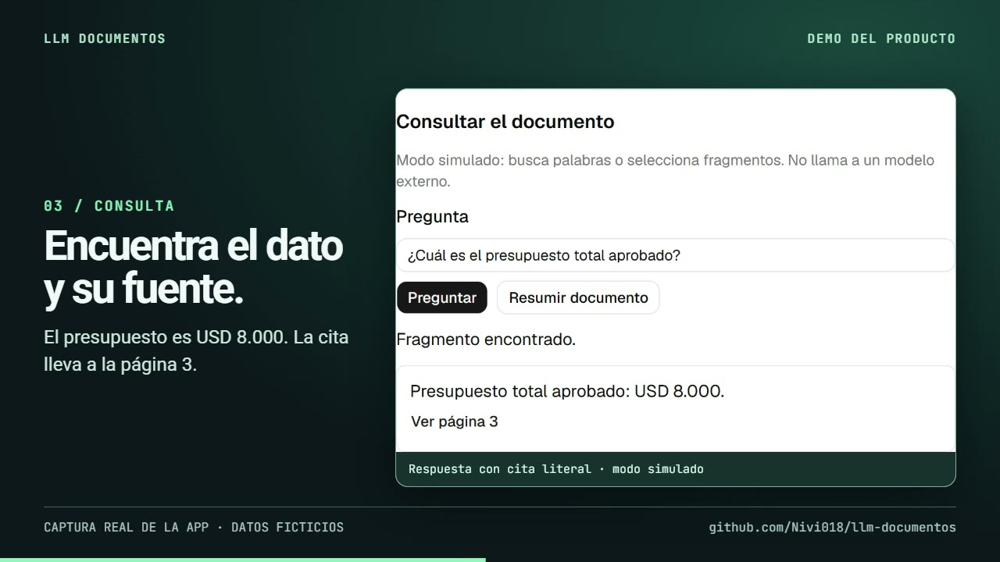

# LLM Documentos

[](https://github.com/Nivi018/llm-documentos/actions/workflows/ci.yml)

**Asistente documental local para consultar, resumir y editar PDF, Word y TXT.** Encuentra el pasaje que respalda una respuesta y descarga una copia editable sin sobrescribir el original.

El proyecto resuelve dos problemas: comprobar de dónde sale un dato y mantener el control de qué cambios llegan al archivo final. Funciona en modo simulado sin configurar un modelo; **Ollama + Qwen3 4B** habilita IA local opcional, sin una clave ni pago por consulta. No hay cuentas, base de datos ni historial persistente.

| Flujo | Qué puedes hacer |
| --- | --- |
| **Leer** | Cargar un archivo y navegar por páginas, párrafos o líneas. |
| **Consultar** | Hacer preguntas con citas navegables. En Ollama, buscar fragmentos relevantes incluso si el documento completo no cabe en el contexto. |
| **Resumir** | Crear un resumen corto o procesar texto largo por bloques, detenerlo entre bloques y combinar los resultados con citas. |
| **Editar y exportar** | Elegir coincidencias, editar un fragmento o pedir una reescritura local; comparar cambios, deshacer o rehacer y exportar DOCX. |

[Instalación](#iniciar-en-windows) · [Ejemplos](#prueba-rápida) · [Proveedores](#configuración) · [Arquitectura](docs/arquitectura.md) · [API](docs/api.md) · [Pruebas](#comprobaciones)

## Demo en video

[](docs/demo.mp4)

[Ver o descargar el MP4](docs/demo.mp4) · [Cómo reproducir la captura y el render](demo/README.md)

Demo de 35 segundos con capturas reales de la app en modo simulado. Muestra cómo cargar un PDF ficticio, comprobar una cita, revisar un reemplazo y descargar el DOCX. Playwright ejecuta el flujo en Chromium; HyperFrames compone el video. No requiere una clave de IA.

## Iniciar en Windows

Requisitos: Git, [uv](https://docs.astral.sh/uv/) y Node.js 22.13+ (rama 22) o 24+. Clona el repositorio:

```powershell
git clone https://github.com/Nivi018/llm-documentos.git
Set-Location llm-documentos
```

Ejecuta estos comandos desde la raíz del proyecto en dos terminales PowerShell. En macOS o Linux, usa `npm` en lugar de `npm.cmd` y `export LLM_PROVIDER=ollama` si activas ese proveedor. El flujo interactivo se verificó en Windows.

**API**

```powershell
uv python install 3.13
Set-Location backend
uv sync --locked
uv run --locked uvicorn app.main:create_app --factory --reload --host 127.0.0.1 --port 8000
```

**Interfaz**

```powershell
Set-Location frontend
npm.cmd ci
npm.cmd run dev
```

Abre <http://127.0.0.1:5173>. Vite reenvía `/api` al backend local. La documentación interactiva OpenAPI está en <http://127.0.0.1:8000/docs>.

## Prueba rápida

1. Carga el [PDF ficticio](ejemplos/biblioteca-horizonte.pdf) y pulsa **Extraer texto**.
2. Pregunta «¿Cuál es el presupuesto total aprobado?». La aplicación debe citar **USD 8.000**, página 3.
3. Busca `USD 8.000`, reemplázalo por `USD 8.500`, previsualiza y agrega el cambio. Descarga el DOCX y verifica que el PDF sigue intacto.

Los [archivos de ejemplo](ejemplos/) son ficticios. Para probar búsquedas en documentos largos, usa el [PDF de 13 páginas](ejemplos/piloto-archivo-largo.pdf) con Ollama.

La vista previa admite un archivo a la vez: PDF con texto, Word (`.docx`) o TXT en UTF-8. Límite: 10 MiB, 500.000 caracteres extraídos y 100 páginas de PDF, párrafos de Word o líneas de TXT, según el formato. Word se lee por párrafos del cuerpo, sin extraer tablas, cabeceras, notas ni imágenes. El backend procesa el archivo en memoria y la interfaz solo conserva el resultado mientras la página esté abierta. No hay OCR y no se admiten PDF cifrados.

Prueba [el Word ficticio](ejemplos/huerto-del-barrio.docx) o [su versión TXT](ejemplos/huerto-del-barrio.txt): pregunta por el presupuesto total aprobado. La cita de **USD 2.400** corresponde al párrafo 4 de Word o a la línea 4 del TXT. Luego reemplázalo por `USD 2.750` y descarga una copia DOCX.

Después de extraer el texto, en **Consultar el documento** puedes preguntar «¿Cuál es el presupuesto total aprobado?» o pulsar **Resumir documento**. Cada resultado incluye fragmentos del PDF con un botón para abrir su página. El modo simulado busca coincidencias de palabras y muestra una selección de fragmentos (hasta ocho, empezando por las primeras páginas con texto); no hace inferencias, y que no encuentre una coincidencia no significa que el dato no esté en el documento.

En **Crear una copia en Word**, busca `USD 8.000` y reemplázalo por `USD 8.500`. Pulsa **Previsualizar cambios** para revisar el antes y el después en la página 3. Cada coincidencia exacta aparece resaltada en **Antes** con una casilla: todas empiezan marcadas y puedes desmarcar las que quieras conservar. **Después** se actualiza al cambiar la selección. Si la búsqueda supera las 500 coincidencias, busca un texto más específico. Pulsa **Agregar a los cambios** para guardar la selección en la copia de trabajo y repite el proceso para preparar otro reemplazo. Puedes acumular hasta 20 pasos, revisar el resultado y deshacer el último. **Descargar DOCX** exporta solo los pasos agregados. El archivo mantiene el orden del texto, no la maquetación, imágenes ni tablas. El original no se modifica ni se envía contenido a un modelo.

Para probar los cambios acumulados, carga [el TXT con dos importes iguales](ejemplos/presupuesto-repetido.txt). Busca `USD 2.400`, reemplázalo por `USD 2.750`, desmarca la línea 2 y agrega el cambio. Luego reemplaza `Huerto del Barrio Sur` por `Huerto Comunitario` y agrega ese cambio. La copia debe mostrar el nuevo nombre y el presupuesto vigente de `USD 2.750`, conservando el histórico de `USD 2.400`.

También puedes elegir **Editar un fragmento** en **Forma de editar**. En ese mismo TXT, selecciona la línea 4, reescribe la nota en **Después**, compárala con **Antes** y pulsa **Agregar a los cambios**. La edición directa comparte la revisión, el historial de deshacer y la exportación con los reemplazos. Al cambiar de fragmento o de modo solo se conservan las ediciones ya agregadas.

Antes de exportar, abre **Cambios acumulados → Comparar con el original**. Verás el antes y el después solo de los fragmentos que siguen siendo distintos. Si deshaces un cambio o el texto vuelve a coincidir con el original, la comparación se actualiza. El DOCX incluye también los fragmentos intactos.

Usa **Deshacer último cambio** y **Rehacer cambio** para recorrer los pasos agregados antes de exportar. Una edición nueva elimina los pasos pendientes de rehacer. Deshacer o rehacer descarta la vista previa sin agregar, pero no modifica el archivo original.

## Configuración

Por defecto, `LLM_PROVIDER=stub`: ofrece consultas y resúmenes extractivos simulados, sin llamadas externas ni credenciales. La variable está documentada en `.env.example`. Si necesitas definirla explícitamente, ejecuta `$env:LLM_PROVIDER = "stub"` en la terminal del backend antes de iniciarlo. No se carga `.env` automáticamente.

### Activar Qwen3 4B con Ollama (opcional)

Instala [Ollama](https://ollama.com/download), inícialo y descarga `qwen3:4b` (aprox. 2,5 GB). En la terminal del backend, **antes de iniciar FastAPI**:

```powershell
ollama pull qwen3:4b
$env:LLM_PROVIDER = "ollama"
```

Este modo usa CPU y solo se comunica con `127.0.0.1:11434`: no necesita claves ni tiene respaldo remoto. Para evitar truncar el documento en un contexto de 4096 tokens, admite hasta 2800 bytes UTF-8 de entrada serializada (incluidas la pregunta y las referencias). Puede tardar alrededor de un minuto en resumir. La app comprueba las citas contra el original y, ante preguntas directas reconocibles sobre un correo, exige que esté en la respuesta y en una cita. No es una garantía general de exactitud. Vuelve a `stub` y reinicia FastAPI para usar el modo simulado.

Si **una pregunta** supera ese límite, la app busca en todo el texto extraído y selecciona hasta ocho fragmentos que quepan en él. Da prioridad a palabras menos frecuentes y conserva la página, párrafo o línea de origen. El modelo solo puede citar fragmentos que recibió. Si no hay coincidencias, la app no llama a Ollama. La búsqueda por palabras puede pasar por alto sinónimos o pasajes relevantes: si no encuentra evidencia, intenta reformular la pregunta. El límite de documentos cortos sigue aplicando a **Resumir documento**.

Para probarlo, carga el [PDF ficticio de 13 páginas](ejemplos/piloto-archivo-largo.pdf) y pregunta «¿Cuál es el código del acta de recepción del piloto?». La respuesta esperada es **HZ-47Q-2027**, en la **página 13**.

Para documentos que no caben en un resumen normal, usa **Consultar el documento → Resumir por bloques**. La app divide el texto en orden (hasta ocho bloques), los procesa uno por uno y muestra cada resumen con citas. **Detener después del bloque actual** conserva los resultados ya obtenidos y evita iniciar el siguiente. En CPU puede tardar varios minutos.

Cuando todos los bloques tengan un resumen con citas, pulsa **Combinar en un resumen global**. Ollama recibe versiones acotadas de los resúmenes y sus referencias. La app exige al menos una cita verificable por bloque y copia las citas del original, no del texto que genere el modelo. Los resúmenes parciales quedan visibles si la combinación falla. La verificación de citas no garantiza que cada afirmación generada esté respaldada.

En el modo Ollama, en **Crear una copia en Word → Editar un fragmento**, selecciona una página, un párrafo o una línea y escribe una instrucción. **Proponer reescritura** envía a Ollama solo ese fragmento y la instrucción. La propuesta aparece en **Después**, puedes ajustarla a mano y solo entra en el DOCX si pulsas **Agregar a los cambios**. Para probar, selecciona la línea 4 del [TXT de ejemplo](ejemplos/presupuesto-repetido.txt) y pide «Cambia la expresión “se conserva” por “se mantiene” y conserva el resto exactamente igual». Las instrucciones vagas de tono pueden devolver el texto sin cambios; en ese caso, concreta qué quieres modificar. Revisa siempre el significado de la propuesta.

### Probar GPT 6 Luna (opcional)

[OpenCode Console](https://opencode.ai/docs/console/models/#endpoints) documenta el endpoint de GPT 6 Luna (`gpt-6-luna`) para llamadas directas de pago por uso. Este modo no usa el endpoint ni la cuota de [OpenCode Go](https://opencode.ai/docs/go/), cuyo uso para un chatbot documental no se ha confirmado. Verifica los permisos y el presupuesto de tu cuenta antes de activarlo.

En la terminal del backend, antes de iniciarlo:

```powershell
$env:OPENCODE_API_KEY = [System.Net.NetworkCredential]::new('', (Read-Host 'Clave de OpenCode Console' -AsSecureString)).Password
$env:LLM_PROVIDER = "opencode-console"
```

Carga el PDF ficticio, acepta el aviso de envío y prueba:

- «¿Cuánto dinero se autorizó para el piloto?» → USD 8.000, con cita de la página 3.
- «¿Cuál es el correo de la responsable?» → no hay evidencia suficiente.
- **Resumir documento** → un resumen respaldado por citas.

Las consultas consentidas envían el texto extraído y la pregunta si la hay; nunca el PDF original. El modo remoto rechaza entradas de más de 60 KB serializados. Se solicita `store: false`, lo cual no evita la [retención de hasta 30 días](https://opencode.ai/docs/console/models/#privacy) documentada para las API de OpenAI en Console. Evita documentos sensibles en esta prueba. Las citas se cotejan contra el PDF; esto no garantiza que cada afirmación del modelo esté respaldada. La comprobación de configuración no hace llamadas externas ni valida la clave. Para volver al modo local, cambia `LLM_PROVIDER` a `stub` y reinicia la API.

## Comprobaciones

### Prueba manual con Ollama local

Con Ollama iniciado en `127.0.0.1:11434` y `qwen3:4b` descargado, ejecuta desde `backend/`:

```powershell
uv run --locked python scripts/test_ollama_local.py --suite todo
```

La prueba usa solo documentos ficticios, fuerza CPU y comprueba citas literales. Evalúa **el modelo directamente**, no las reglas adicionales de la API: si Qwen responde con un dato relacionado en lugar de reconocer que falta, la prueba lo marca como fallo. No cambia el proveedor de la app. Usa `--suite pdf` o `--suite formatos` para ejecutar solo una parte.

### Pruebas del proyecto

Desde `backend/`:

```powershell
uv run --locked ruff check
uv run --locked ruff format --check
uv run --locked mypy app tests
uv run --locked pytest
```

Desde `frontend/`:

```powershell
npm.cmd run lint
npm.cmd run typecheck
npm.cmd test
npm.cmd run build
```

## Límites y próximos pasos

- **Escaneos:** OCR local todavía no está implementado.
- **Exportación:** recupera texto editable, no el diseño original ni los objetos de Word o PDF.
- **IA:** las citas se verifican literalmente, pero pueden no respaldar todas las afirmaciones. La búsqueda por palabras puede omitir sinónimos. En CPU, los resúmenes largos pueden tardar varios minutos.
- **Alcance:** un archivo por sesión; no hay cuentas, historial persistente ni colaboración. No expongas los servidores de desarrollo a Internet.
- **OpenCode Go:** no configurado para este caso de uso. La alternativa Console es de pago por uso y su calidad no se ha comprobado con una llamada real.

El siguiente paso sugerido es [OCR local bajo demanda](docs/arquitectura.md#límites-y-decisión-de-alcance).
