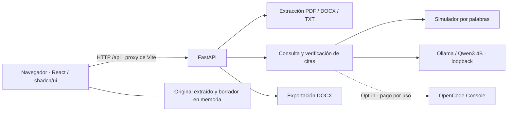

# Arquitectura

LLM Documentos separa extracción, consulta y edición. La salida de un modelo no cambia el borrador: los cambios pasan por una revisión explícita y solo se exportan cuando el usuario los agrega.

## Estructura

| Ruta | Responsabilidad |
| --- | --- |
| [`frontend/src/`](../frontend/src/) | Interfaz, cliente HTTP, carga, navegación de citas y revisión de cambios. |
| [`frontend/src/document-edits.ts`](../frontend/src/document-edits.ts) | Reemplazos literales seleccionables, ediciones directas, comparación, deshacer y rehacer. |
| [`backend/app/main.py`](../backend/app/main.py) | Configuración de FastAPI y selección del proveedor mediante variable de entorno. |
| [`backend/app/pdf.py`](../backend/app/pdf.py) · [`text_preview.py`](../backend/app/text_preview.py) | Lectura acotada de archivos, extracción con pypdf y python-docx, TXT UTF-8. |
| [`backend/app/retrieval.py`](../backend/app/retrieval.py) | Búsqueda de fragmentos para preguntas en documentos largos. |
| [`backend/app/block_summary.py`](../backend/app/block_summary.py) | Plan de bloques, resúmenes parciales y síntesis con referencias al origen. |
| [`backend/app/ollama_provider.py`](../backend/app/ollama_provider.py) | Llamadas locales y validación de respuestas estructuradas. |
| [`backend/app/docx_export.py`](../backend/app/docx_export.py) | Generación de una copia Word en memoria. |
| [`ejemplos/`](../ejemplos/) | Archivos ficticios para demos y pruebas de regresión. |

## Decisiones

- **Referencias estables.** La unidad de origen es una página de PDF, un párrafo del cuerpo de Word o una línea de TXT. Se conserva su número al seleccionar o partir el texto. Una cita debe aparecer literalmente en el fragmento correspondiente antes de mostrarse.
- **Contexto acotado.** Ollama usa 4096 tokens de contexto y un límite conservador de 2800 bytes UTF-8 para el contenido serializado. Para preguntas largas, se puntúan ventanas de texto por coincidencias, dando más peso a términos menos frecuentes. No hacen falta embeddings, índices persistentes ni bases vectoriales. Si no se recupera un pasaje, la app indica que no halló evidencia; no afirma que el dato no exista.
- **Resumen en dos etapas.** El cliente solicita un plan, procesa hasta ocho bloques en secuencia y conserva los resultados parciales. Al combinar, Ollama recibe resúmenes y referencias acotados. El servidor vuelve a contrastar las citas con el texto original y exige al menos una referencia por bloque. Esto valida la procedencia de la cita, no todas las inferencias del modelo.
- **Edición revisable.** El borrador vive en el navegador. Un reemplazo solo afecta las coincidencias seleccionadas; la reescritura local recibe únicamente un fragmento e instrucción y devuelve una propuesta. El exportador recibe el texto aprobado y genera un DOCX nuevo.
- **Local por defecto.** `stub` no hace llamadas externas; `ollama` usa loopback y no tiene respaldo remoto. `opencode-console` requiere configuración explícita y confirmación del envío. No se almacenan documentos ni historial, aunque el contenido procesado está en memoria durante la sesión. Los límites de tamaño no convierten a la app en un servicio multiusuario ni en un entorno aislado para archivos hostiles.
- **Pruebas reproducibles sin modelo.** Pytest ejercita FastAPI con transportes simulados; el frontend usa el ejecutor de Node para comprobar contratos, edición y progreso. Las pruebas reales de Ollama son independientes y no se ejecutan en CI.

## Límites y decisión de alcance

La versión cubre archivos con texto y un usuario local. No conserva la maquetación de origen, no hace OCR ni interpreta tablas de Word y no mantiene múltiples documentos abiertos. Un paso siguiente es reconocer bajo demanda las páginas escaneadas sin reprocesar las que ya contienen texto.
